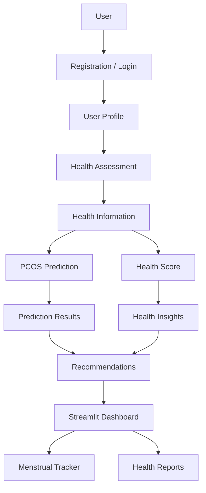
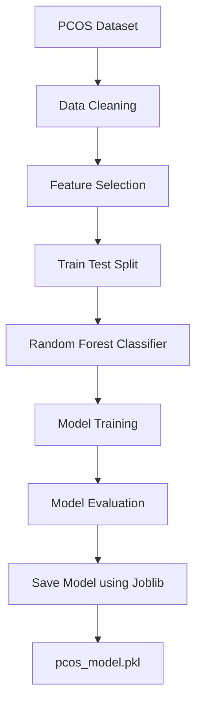
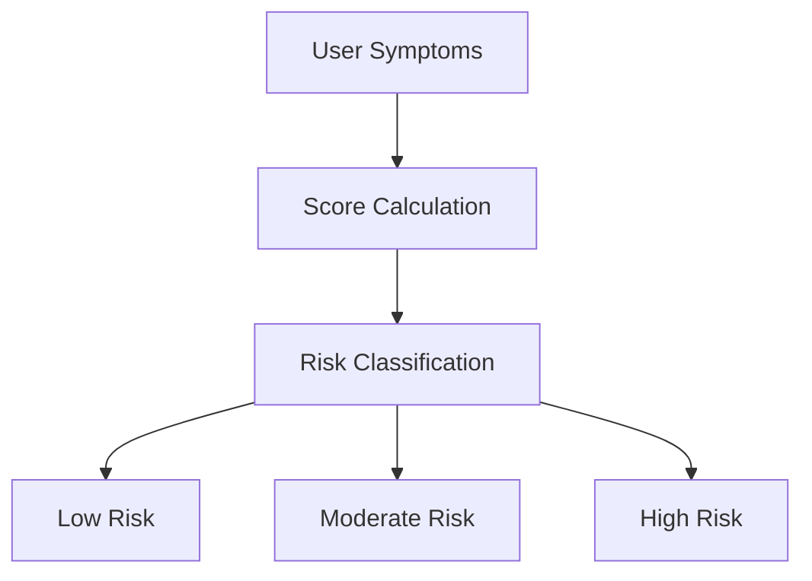

# 💜 FemCare AI

## AI-Powered Women's Health & Wellness Platform

FemCare AI is a women's healthcare and wellness application designed to support health monitoring through PCOS risk assessment, health scoring, menstrual tracking, personalized recommendations, and report generation.

The project combines Python, machine learning, rule-based prediction logic, and an interactive Streamlit interface to provide a centralized platform for monitoring important aspects of women's health.

> **Disclaimer:** FemCare AI is an academic/research project intended for educational and informational purposes. Its predictions and recommendations are not medical diagnoses and should not replace consultation with qualified healthcare professionals.

---

## 📌 Project Overview

Women's health involves multiple interconnected factors, including menstrual health, lifestyle, symptoms, and conditions such as Polycystic Ovary Syndrome (PCOS).

FemCare AI aims to provide a convenient digital platform where users can:

- Register and manage their profiles
- Perform health assessments
- Obtain PCOS risk assessments
- Calculate health scores
- Track menstrual cycles
- Monitor health information through a dashboard
- Receive health-related recommendations
- Generate health reports

The project demonstrates how Python-based application development and machine learning can be applied to a healthcare-support system.

---

## ✨ Key Features

### 🔐 User Registration & Login
- User registration
- Login functionality
- User profile management
- Local database-based user management

### 🩺 Health Assessment
Users can provide relevant health information through the health assessment module.

The application processes the provided information to generate health-related insights.

### 🧠 PCOS Prediction

The project includes a Random Forest machine learning model trained using a PCOS dataset.

It also contains a separate rule-based scoring function for classifying risk levels based on selected symptoms.

**Machine Learning Model:**
- Random Forest Classifier
- Scikit-learn
- Dataset preprocessing
- Training and testing
- Accuracy evaluation
- Model saving using Joblib

**Rule-Based Prediction:**
- Irregular periods
- Acne
- Hair loss
- Weight gain
- Mood swings

The rule-based function assigns scores to these inputs and returns Low Risk, Moderate Risk, or High Risk.

### 📊 Health Score
The application calculates a health score using the implemented health-score module.

### 🌸 Menstrual Tracker
A dedicated page for recording and monitoring menstrual-cycle information.

### 📈 Interactive Dashboard
Provides a centralized view of relevant health information and application results.

### 💡 Health Recommendations
Generates health-related recommendations based on the information processed by the application.

### 📄 Health Report
Provides functionality for presenting health-related information and results in a structured report.

---

## 🏗️ Project Architecture

FemCare AI follows a modular architecture that combines user management, health assessment, prediction logic, health scoring, menstrual tracking, and reporting.



### Machine Learning Workflow

The Random Forest model training process is implemented in `model.py`.



### Rule-Based Prediction Workflow

The separate rule-based prediction function is implemented in `pcos_predictor.py`.



---

## 🛠️ Technologies Used

| Category | Technologies |
|---|---|
| Programming Language | Python |
| Application Framework | Streamlit |
| Machine Learning Library | Scikit-learn |
| ML Algorithm | Random Forest Classifier |
| Data Processing | Pandas |
| Model Serialization | Joblib |
| Prediction Logic | Rule-Based Scoring System |
| Dataset | PCOS Dataset (CSV) |
| Styling | HTML, CSS |
| Development Tools | VS Code, Git, GitHub |

---

## 📁 Project Structure

```text
FemCare-AI/
│
├── app.py
├── database.py
├── model.py
├── health_score.py
├── hero.py
├── pcos_predictor.py
├── recommendation.py
├── theme.py
│
├── PCOS_data.csv
├── pcos_model.pkl
├── FemCare_Report.pdf
│
├── style.css
├── check_db.py
├── clear_users.py
│
├── pages/
│   ├── 1_register.py
│   ├── 2_login.py
│   ├── 3_profile.py
│   ├── 4_Health_Assessment.py
│   ├── 5_dashboard.py
│   ├── 6_report.py
│   └── 7_Menstrual_Tracker.py
│
├── .gitignore
└── README.md
```

### Main Components

| File | Description |
|---|---|
| `app.py` | Main Streamlit application |
| `database.py` | Database-related operations |
| `model.py` | Random Forest model training and evaluation |
| `pcos_predictor.py` | Rule-based PCOS risk prediction |
| `health_score.py` | Health score calculation |
| `recommendation.py` | Health recommendation logic |
| `theme.py` | Application theme settings |
| `style.css` | Custom styling |
| `PCOS_data.csv` | PCOS dataset |
| `pcos_model.pkl` | Saved machine learning model |
| `pages/` | Application pages |

---

## ⚙️ Installation & Setup

Follow these steps to run FemCare AI locally.

### Prerequisites

- Python 3.9 or above
- Git
- VS Code or another Python IDE

### 1. Clone the Repository

```bash
git clone https://github.com/NelluriVarsha/FemCare-AI.git
```

### 2. Navigate to the Project Directory

```bash
cd FemCare-AI
```

### 3. Create a Virtual Environment

```bash
python -m venv venv
```

### 4. Activate the Virtual Environment

**Windows:**

```bash
venv\Scripts\activate
```

### 5. Install Dependencies

```bash
pip install streamlit pandas scikit-learn joblib
```

Install any additional packages required by the other application modules.

### 6. Run the Application

```bash
streamlit run app.py
```

### 7. Open in Browser

The application will be available at:

```text
http://localhost:8501
```

Open the displayed URL in your browser to access FemCare AI.

---

## 🔄 Application Workflow

1. **Registration:** The user creates an account.
2. **Login:** The registered user logs into the application.
3. **Profile:** The user provides or views profile information.
4. **Health Assessment:** The user provides relevant health information.
5. **PCOS Risk Assessment:** The application provides its implemented prediction results.
6. **Health Score:** The application calculates a health score.
7. **Recommendations:** Health-related recommendations are generated.
8. **Dashboard:** The user views relevant results and health information.
9. **Menstrual Tracking:** The user records and monitors menstrual-cycle information.
10. **Report:** The application provides health-report functionality.

---

## 🎯 Project Objectives

1. Develop an interactive women's health application.
2. Implement machine learning-based PCOS prediction.
3. Provide a health assessment interface.
4. Calculate and display health scores.
5. Provide menstrual tracking functionality.
6. Generate health-related recommendations.
7. Present health information through an interactive dashboard.
8. Generate structured health reports.
9. Demonstrate the application of machine learning in healthcare-support systems.

---

## 🌱 Future Enhancements

### 🤖 Advanced AI Models
- Experiment with ensemble learning and deep learning approaches.
- Compare multiple machine learning algorithms.
- Improve model evaluation using appropriate validation techniques.

### 🧬 Multimodal Health Analysis
Explore combining multiple information sources, including:
- Symptoms
- Lifestyle information
- Menstrual history
- Clinical measurements
- Laboratory results

### 📱 Mobile Application
Develop a dedicated Android/iOS application.

### ☁️ Cloud Deployment
Deploy the application using cloud platforms for remote access and scalability.

### 📊 Advanced Analytics
- Health trends
- Menstrual-cycle analytics
- Historical prediction tracking
- Interactive charts
- Personalized progress monitoring

### 🔔 Notifications
Implement reminders for menstrual tracking, health assessments, appointments, and wellness routines.

### 🔐 Enhanced Security
- Password hashing
- Secure authentication
- Role-based access
- Improved database security
- Secure handling of sensitive health information

### 🩺 Clinical Integration
Explore integration with healthcare professionals and clinical systems, subject to appropriate validation, privacy, and regulatory requirements.

---

## 🔒 Privacy & Security

FemCare AI may process sensitive health-related information.

For a production deployment, additional security measures should be implemented, including:

- Secure authentication
- Password hashing
- Encryption
- Access control
- Secure database management
- Protection of personal and health information

Users should avoid uploading real sensitive medical information to an unsecured development deployment.

---

## ⚠️ Medical Disclaimer

FemCare AI is developed as an academic and research project.

The predictions, health scores, recommendations, and reports generated by the application are intended for educational and informational purposes only.

They should not be used as a substitute for:

- Professional medical advice
- Clinical diagnosis
- Medical treatment
- Laboratory testing
- Consultation with a qualified healthcare professional

Any healthcare-related decision should be made in consultation with an appropriate medical professional.

---

## 🚀 Future Vision

FemCare AI aims to serve as a foundation for a more comprehensive AI-assisted women's health-support platform.

Future development could focus on combining:

```text
Machine Learning
       +
Health Assessment
       +
Menstrual Tracking
       +
Personalized Recommendations
       +
Health Analytics
       +
Clinical Support
```

to create a more comprehensive and responsible digital health-support system.

---

**💜 FemCare AI | Final Year Project**

*Machine Learning-Based Women's Health Monitoring Platform*
